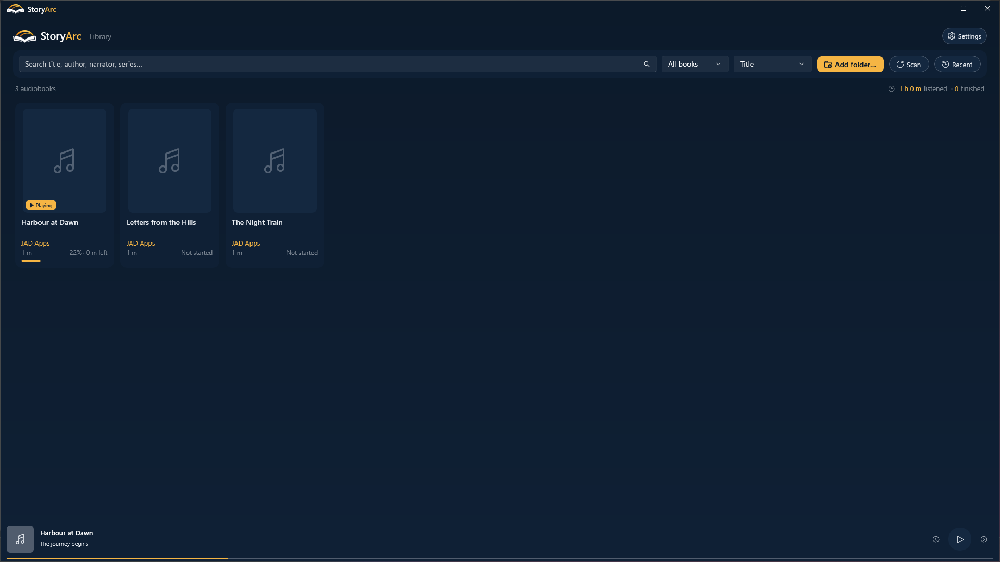
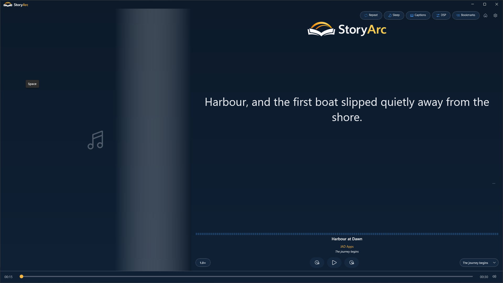
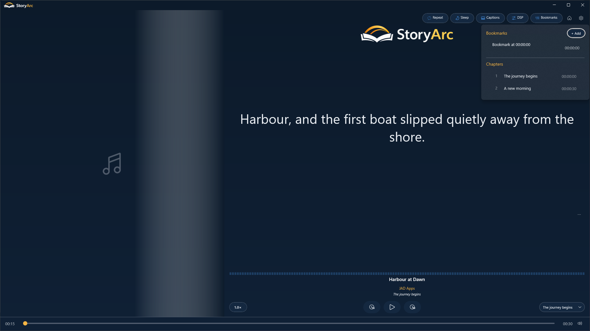
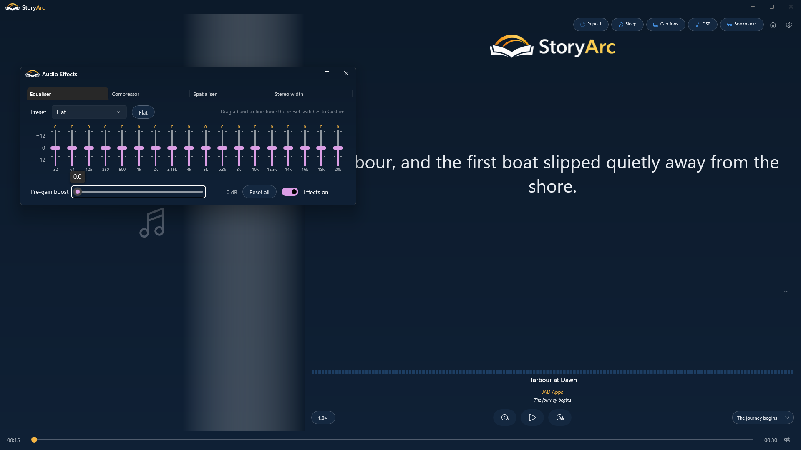
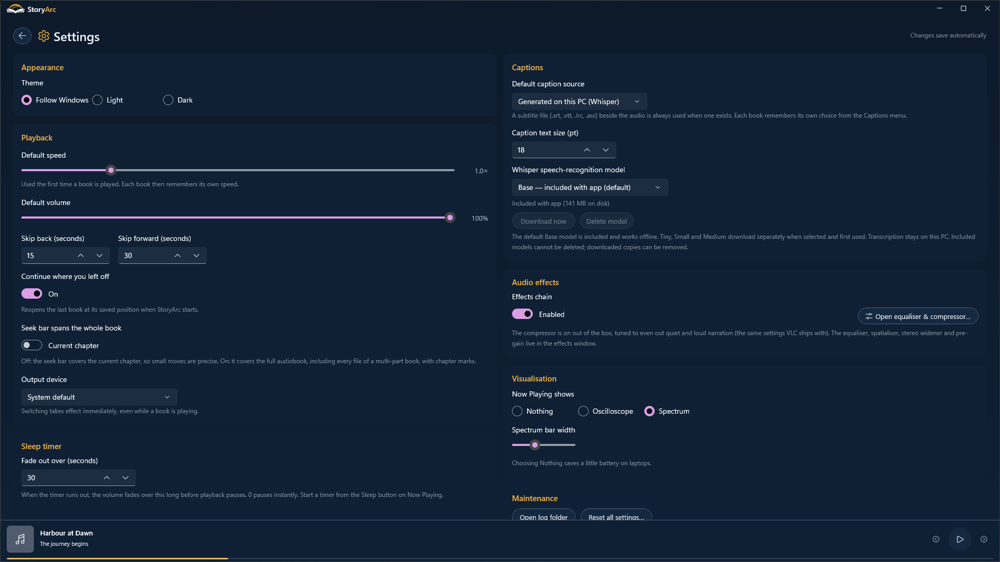

# StoryArc

An audiobook player for Windows 11 from [JAD Apps](https://jadapps.app/).

**[Get StoryArc on the Microsoft Store](https://apps.microsoft.com/detail/9pmrsl2r7jz4)**

StoryArc plays your local audiobooks, with chapter navigation, bookmarks, saved
playback position, adjustable speed, audio effects and a sleep timer. It can show
external subtitles or generate captions on your device using an optional Whisper
model download.

**Status:** Released on the Microsoft Store. No audiobooks are included.

## Screenshots

*Browse your local audiobook library.*

*Follow captions generated locally on your PC.*

*Save bookmarks and navigate chapters.*

*Adjust the equaliser and audio effects.*

*Choose playback, caption and appearance preferences.*

## Project and support

This public repository contains product information, privacy information
and support issues. The application implementation, including
its caption and playback components, is maintained privately.

- [Privacy policy](PRIVACY.md)
- [Report an issue](https://github.com/JAD-Apps/StoryArc/issues)
- [JAD Apps website](https://jadapps.app/)
- [More JAD Apps projects](https://jadapps.app/studio)

StoryArc is proprietary software. Third-party libraries and models retain their
own licences. See [COPYRIGHT.md](COPYRIGHT.md).
